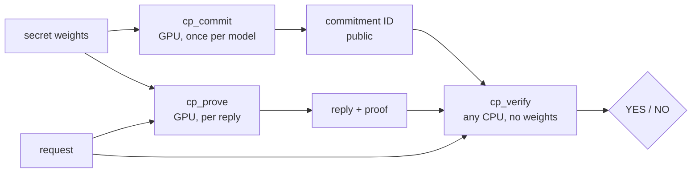

# What this fork is, in plain language

This fork is research on zero-knowledge proofs of LLM inference, building on [Anthropic's FlashProve](https://github.com/anthropics/FlashProve). This page explains what upstream gave us, what we have checked ourselves, what we have added, and what is still open. The [README results table](../../README.md#fork-status--results) has the numbers. Each number links to its evidence on `main`.

## The idea in one paragraph

An AI provider says "this reply came from model X." Normally you have to trust them. FlashProve lets the provider attach a **proof** to each reply. Anyone can check the proof on an ordinary CPU, without seeing the model's weights. The provider first publishes a **commitment**, a short ID that binds it to one set of weights. Then the GPU computes the reply and a proof that this reply is what the committed model produces for this request. A **verifier** program (`cp_verify`) reads the proof and prints `YES` or `NO`.

Some limits of the idea itself, from upstream's own documentation: what is proved is an **integer version** of the model, not the 16-bit or FP8 model a normal server runs. The proved context is 1,024 tokens. A `YES` says the reply matches the committed integer model under the stated policy; it does not say the provider runs that model for everyone, or that the model is good. See [guide/what-is-proved.md](../../guide/what-is-proved.md) and [guide/known-limits.md](../../guide/known-limits.md).

## What upstream had

Upstream released version 0.16.0 as a research artifact (not maintained, Apache 2.0). It includes the prover, the C++ verifier, a Lean verifier, formal results for its own relation, and stored example proofs. Its headline figures are for Llama 4 Maverick in a public 4-bit conversion on one H100, at about 111 tokens per second at 24 requests per batch, with proofs of about 18.8 MB ([guide/performance.md](../../guide/performance.md)). The guide says itself that the runs' records are not in the repository, so outsiders cannot check those figures against them.

## What we reproduced

- **CPU verification of the stored proofs.** We built the verifier from upstream's pinned source and checked its stored synthetic-weight proofs. Both were accepted, and every altered copy in upstream's two ten-case tables was rejected. An independent review in a separate clone added 19 more negative cases. ([research/reproduction/](../../research/reproduction/README.md))
- **A small proof on a real GPU.** We rented one H100 and ran upstream's small quickstart example (made-up weights, one request). The proof was accepted by a verifier built separately on a different, CPU-only machine, and one-bit changes to the proof, answer, request or ID were rejected. ([research/gpu/](../../research/gpu/README.md))
- **That GPU run, again, by someone else.** A second lane that did not do the first run repeated it on a new rental from the written instructions alone. It agreed: same answer token, same accepted verdicts, proving in about 2.35 s per request. Committing took longer on that machine (about 18.8 s against about 13 s), with the same dominant phase. ([research/gpu/replication-1/](../../research/gpu/replication-1/README.md))

This is upstream's **small example**, not its headline result. We have not run the full-size model.

## What we extended

- **A faster verifier, with nothing it checks changed.** A profile showed that much of the verifier's planning time went to allocating memory for big-number arithmetic. Keeping short numbers inline made complete verification of a stored proof 15 to 18% faster on one thread, across two independent measurements. Verdicts and output were byte-identical on the honest case and eight altered ones. ([research/performance/real/](../../research/performance/real/README.md))
- **Honest negative results.** Our first CPU baseline and a first optimization attempt found **no** speedup, and say so. They stay on `main` as evidence. ([research/performance/](../../research/performance/README.md))
- **A first step toward new model operators.** A tiny proof of one step of a KDA-style linear-attention recurrence, in fixed point: one token, one head, dimension 1. It proves and verifies, and 50 hostile proofs are rejected. It also shows that this coarse fixed point does **not** match floating point, which is the point of measuring it. ([research/operators/glm_kda_fixedpoint/](../../research/operators/glm_kda_fixedpoint/README.md))
- **Evidence hygiene.** Full CPU-suite counts, held integration work with its open gates written down, and a script that keeps local machine paths out of published evidence ([scripts/check-no-host-paths.sh](../../scripts/check-no-host-paths.sh)).

## What is not done

- No run on the full-size model, or on any real model's weights, on a GPU.
- No serving, batching or long-context results of our own.
- No support for new model families. The operator work is a toy-sized slice, not a port.
- No measurement of how often a normal (16-bit or FP8) server's replies would pass the integer model's check, beyond what upstream reports.
- No TEE or hardware attestation, and no production use.
- The held integration work (PR #20) is not approved for adoption.

Other teams work on related problems, some with different trust models (for example, hardware enclaves) and different speed trade-offs. This fork makes no claim to be first or fastest. Its aim is results that someone else can rerun and check.
