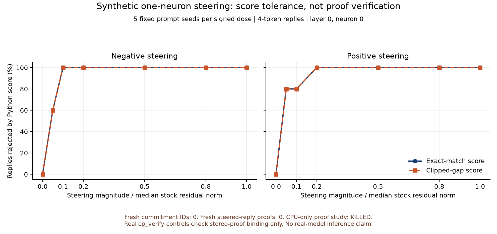

# Synthetic model identity and runtime steering, CPU Stage 1

## Verdict: KILLED for the requested proof experiment

**The CPU path evaluates the integer model and verifies existing proofs. It cannot create a new commitment or proof.** `cp_commit` and `cp_prove` require CUDA/H100 (`prover/build.sh:5-15`); the stored small proof was made on a GPU (`examples/accepted-proof/README.md`, "How the files were made"). No GPU was used or rented.

The preregistered success threshold required 15 fresh variant commitments with reproduced IDs and fresh proof decisions. Actual counts: **0 fresh commitments, 0 fresh proofs, 0 steered-reply `cp_verify` checks**. No measured smallest *verifier-detected* dose exists in this result. The output below is a partial CPU experiment, not a substitute proof result.

There is also a narrowly scoped negative CPU observation: **in this fixed grid, the default lenient score accepted none of the changed runtime-steered replies**. It agreed with strict scoring on all 65 cases. This holds only for the tested grid (smallest nonzero dose 0.05), four-token replies, and the exact fixture's scales (see the scale caveat below). Doses below 0.05 and replies longer than four tokens were not tested. Short replies leave the clipped-gap budget the least room, so this is **not** evidence that clipped-gap rejects small steering in general. We did not tune thresholds, increase the reply length, or select another neuron to obtain a more interesting curve.

## What was measured

- Same eight-layer synthetic block-weight model as `examples/accepted-proof`, weight-generator seed 31, dimension 512, vocabulary 512. A test compares all four covered greedy choices with the stored exact-match fixture.
- Five independent **prompt** seeds: 1103, 1104, 1105, 1106, 1107. These are not five models or cryptographic trials.
- Eight prompt tokens and four generated reply tokens per case. One neuron, shared/dense down column 0 at layer 0. At every prompt and generated-token position, add `round(dose * median_stock_residual_norm * Wd[:,0] / ||Wd[:,0]||)` after that layer's MLP residual update. Norm is measured across the eight stock prompt positions, separately per prompt.
- Doses: 0 and both signs of 0.05, 0.1, 0.2, 0.5, 0.8, 1.0. A fresh stock reference evaluation scores the generated reply on its own autoregressive prefix, with padding through the full 64-token window for range checks.
- Strict `(C, theta, cap)=(256,256,0)`; lenient `(9244130,323343,1)`, with `s=16`, `sh=8`, `sT=4`, `F=24`. These are repository defaults, also the shipped point in the parallel clipped-gap lane. Both score policies here use the **exact fixture's model and scales**. The separate stored lenient proof has its own scales, ID and request; it is not a proof of these scores. The lenient limits were fitted under the clipped-gap fixture's different `config/KL.bin`, so the lenient column here is "fitted limits applied under other scales", not "the shipped lenient configuration".
- No range failures: 65/65 runtime cases and 15/15 weight-variant cases scored. Full per-token gaps and decisions are in `numbers.json`; `raw-scores.json` preserves the scoring data before verifier controls.

The relative-dose algebra matches [neuron-explorer's `--dose-unit rel` implementation](https://github.com/lyramakesmusic/neuron-explorer/blob/7ec363d2d9686802a1b4aa7c6d8a2627b1759159/sweep/steer_sweep.py#L180-L195): coefficient `dose * resid_p50 / down_norm`. Its normalization comes from a calibration corpus; ours is explicitly the eight stock prompt positions, with integer rounding. No Qwen code, weights or named persona neurons are used. The fixed default thresholds align with [clipped-gap lane PR #45](https://github.com/wakesync/flashprove/pull/45), not its fitted alternatives.

`steering-score.png` is deliberately labeled **Python score, not proof verification**. `plot.py` regenerates it.



## Dose results

Each signed dose has n=5. Rejection columns are counts out of five, not independent security estimates. Changed-token summaries are median [minimum, maximum], sample SD in parentheses.

| Signed dose | Strict score rejects | Lenient score rejects | Changed tokens, out of 4 |
|---:|---:|---:|---:|
| 0 | 0/5 | 0/5 | 0 [0,0] (0) |
| -0.05 | 3/5 | 3/5 | 2 [0,4] (1.789) |
| +0.05 | 4/5 | 4/5 | 3 [0,4] (1.673) |
| -0.1 | 5/5 | 5/5 | 2 [2,4] (0.894) |
| +0.1 | 4/5 | 4/5 | 4 [0,4] (1.789) |
| -0.2 | 5/5 | 5/5 | 4 [3,4] (0.447) |
| +0.2 | 5/5 | 5/5 | 4 [2,4] (0.894) |
| -0.5, +0.5, -0.8, +0.8, -1.0, +1.0, each | 5/5 | 5/5 | 4 [4,4] (0) |

Across the 60 nonzero-dose cases, 56 replies changed and four did not. Strict and lenient scores both rejected all 56 changed replies and accepted all four unchanged replies. Zero-dose controls were accepted 5/5. This does not establish that every smaller dose or another prompt, neuron or length behaves the same way. Not tested below 0.05 or beyond four tokens.

Smallest **tested score-rejected magnitude**, per prompt:

| Prompt seed | Negative, both policies | Positive, both policies |
|---:|---:|---:|
| 1103 | 0.10 | 0.20 |
| 1104 | 0.05 | 0.05 |
| 1105 | 0.10 | 0.05 |
| 1106 | 0.05 | 0.05 |
| 1107 | 0.05 | 0.05 |

- Negative: n=5, median 0.05, SD 0.02739, min 0.05, max 0.10.
- Positive: n=5, median 0.05, SD 0.06708, min 0.05, max 0.20.
- These are coarse grid observations, not continuous detection limits. A rejection at 0.05 does not say the true transition is exactly 0.05.
- **Floor-censored.** Most seeds were already score-rejected at the smallest tested dose, 0.05: 3/5 negative (1104, 1106, 1107) and 4/5 positive (1104 to 1107), matching the -0.05 and +0.05 rows above. So both medians of 0.05 sit on the lower boundary of the grid. They are lower-boundary observations (the true smallest rejected magnitude for those seeds is at most 0.05 and was not resolved), not estimates of where the transition happens. Doses below 0.05 were not tested.
- For Bernoulli rejection indicators, per-dose n, median, sample SD and min/max are retained under `dose_summary` in `numbers.json`. Neither error bars nor five samples constitute a soundness/security bound.

## Three weight artifacts, not three commitments

All variants are exact integer weight sources. The projected variant uses `I - e_0 e_0^T` on every attention output and MLP down projection, including routed down matrices; it zeros embedding coordinate 0 too. There is **no refusal direction or refusal behavior** in this synthetic model.

A constant residual injection is not a new supported weight matrix. The third artifact therefore doubles one down-projection column as an explicitly named **weight-steering surrogate**, not an equivalent implementation of runtime steering. Sixteen entries saturate at the allowed weight range. The actual runtime-steering experiment leaves stock weights unchanged, checked by fingerprints before/after.

| Artifact | Own-model strict score accepts | Stock strict score accepts | Changed tokens: n=5, median [min,max], SD |
|---|---:|---:|---:|
| stock | 5/5 | 5/5 | 0 [0,0], 0 |
| direction projected | 5/5 | 0/5 | 4 [3,4], 0.548 |
| down-column doubled surrogate | 5/5 | 4/5 | 0 [0,2], 0.894 |

These are model-score decisions, not proofs against own or stock IDs. The four matching surrogate replies are a concrete reason not to promise that every modified-model reply must fail exact match.

Three distinct artifact SHA-256 fingerprints were reproduced exactly by a separate process reconstructing all weights from seed 31 and the public configuration. **These are not FlashProve commitment IDs**:

```text
stock                      5ef0dd3d329b198bf398cbda36771bfb31e3685ef0144676269813c751dcce11
direction_projected        14e158fa162a6fcff8a840b066bc169e2e03c1f8fa340cc27cda4c32ce7c9fb9
column_doubled_surrogate   67b4a84f3ed9b6724f142d11999d254a54c45f849aadc7e58d65e47fbe11a0f7
```

`artifact-fingerprints.json` contains canonical per-tensor checksums. `run.py:fingerprint` defines serialization and includes all three configuration files. This is same-code process reproducibility, **not independent implementation or researcher replication**, not the requested public-seed commitment recomputation. The commitment seed remains null in `ENV.json`.

## Real cp_verify: stored-proof controls only

22 completed controls used the unmodified C++ verifier built from the pinned base. Two fixed stored proofs were accepted; ten wrong-ID substitutions and ten covered-token modifications with reused proofs were rejected. For each policy and mutation class, n=5, median rejection indicator 1, SD 0, min=max=1. The unmodified fixture has one call per policy, no variance claim.

| Policy | Case | n | Exit code | Entire last line |
|---|---|---:|---:|---|
| strict | unmodified | 1 | 0 | `YES` |
| lenient | unmodified | 1 | 0 | `WITHIN LIMITS: clipped-gap C=9244130 theta=323343 cap=1 s=16 sh=8` |
| either, separately | wrong expected ID | 5 | 1 | `NO: model-statement` |
| either, separately | changed covered token, old proof | 5 | 1 | `NO: proof-refused` |

Expected IDs for the accepted controls:

- Strict: `79a5a2bc7a469b40df73dedf40abeb740671e8ae8077738bd3743897aeb22183`, `r=60`, `e=64`, tokens 61..63 and next token covered.
- Lenient: `8df714349b76202d6f302bb80b33d6d0798bd81d987b9e387038b7fd24c55ae6`, `r=15`, `e=47`, tokens 16..47, next token not covered.

Full `covered:`, `commitment:`, `proof of work:` and `result-v1` receipts, and every passed ID, are retained in `numbers.json` and `verifier-logs/`. Both accepted controls report 49 commitment-assumed rounds, a code-theorem assumption, and up to 32 counted proof-of-work bits in 38 rounds; their least-round accounting is 128.00 with work and 96.23 without it. These numbers are not a security level and do not establish soundness of the C++ implementation.

**Wrong-ID checks use deliberately arbitrary strings, not commitments to the modified weights. Reusing a proof after changing a token tests statement binding, not the clipped-gap threshold and not steering detection.**

An initial harness call supplied the incomplete `-policy exact-match` string and returned exit 2 before any proof was checked. Its log is preserved as `initial-cli-usage-error.log`. The harness was corrected to the full six-field policy string and rerun. No model outcome was excluded or threshold changed.

The build emitted a shared-parent-directory permission warning: another account may be able to replace files above the checkout. It is preserved with neutral paths in `build.log`; no permissions were changed. Treat binary/build provenance accordingly.

## Why public weights can identify a model, and what still needs doing

The source-level mechanism already exists. `prover/common/public_weights.h:6-12` says the same weight files, configuration, and public 32-byte file regenerate the key, leaf files and ID. Lines 33-44 derive the internal seed using the `CPPW` domain. `prover/hash_commitment/hf_commit.cu:95-105` distinguishes the normal secret random process from deterministic `-public-weights` mode. `examples/maverick/README.md` documents the published-seed workflow. None of that was newly reproduced here.

The checkable statement is **"this ID corresponds to this published artifact and exact configuration"**. Calling that artifact "official" additionally requires authenticating the publisher, revision, conversion and calibration, including quantization. The same weights under different configuration, policy or seed can have different IDs. Publish the weight hashes, revision, conversion manifests, scales, all configuration, public seed, code version and resulting ID together.

Publishing the seed is only appropriate for already-public weights. It removes weight hiding and does not establish privacy of co-batched requests (`docs/what-is-not-hidden.md`, "The option -public-weights").

Needed to complete Stage 1: an authorized GPU run or a separately implemented/tested CPU committer/prover; export each modified integer artifact in a supported weight format; pass the committer's bounds and public-weight guards; generate and independently recompute commitments for each fixed policy; then prove each candidate reply under the stock reference relation and verify it. Proofs under a variant ID checked against stock only test wrong-key binding. To measure acceptance-policy tolerance, fresh proofs must reference stock, not the variant's computation. Do not silently weaken any checks to get those proofs.

## The answer to "which model produced this reply?"

FlashProve checks a relation to a selected committed reference model. It does not classify a reply as stock, abliterated or steered, nor attest the physical origin of a generation. A changed execution can produce the same stock-greedy tokens and satisfy exact match. Clipped-gap intentionally allows some non-greedy outputs when its full budget permits them; this specific short-reply grid (doses from 0.05, four tokens, exact-fixture scales) found no changed outputs within the default budget, which says nothing about smaller doses or longer replies.

The desired proof-based comparison is still open. No real-model, Qwen persona, refusal, "first", security, or general steering-detection claim follows. Qwen3.5-4B's 24 DeltaNet and 8 full-attention layers remain Stage 2 architecture work.

## Reproduce

**Environment provenance.** `run.py` writes `ENV.json` without `commits.experiment_code`, `commits.neuron_explorer_reference` and `toolchain.plot_environment`. Those three fields were added to the committed `ENV.json` by hand after generation, so rerunning `run.py` produces an `ENV.json` that lacks them (and records the local torch build string); `numbers.json`, `raw-scores.json` and `artifact-fingerprints.json` are unaffected. **Torch pin mismatch:** this run used torch 2.9.1 (`+cu128` wheel, CPU only), while `integrations/vllm/integer_model/pyproject.toml` pins `torch==2.13.0`. The independent review on PR #46 reran the same code at the same SHA with torch 2.9.1+cpu and with torch 2.13.0+cpu and reported byte-identical `numbers.json`, `raw-scores.json` and `artifact-fingerprints.json` in both cases (same-code reproduction, not independent replication).

From the repository root, using Python 3.13.12 with torch 2.9.1+cu128 and numpy 2.3.5 (all computation stays on CPU):

```sh
verifier/build.sh
python experiments/20261103-model-identity/run.py
python experiments/20261103-model-identity/test_experiment.py
```

For the chart, a separate Python environment with matplotlib 3.11.2 and numpy 2.5.4 was used:

```sh
python experiments/20261103-model-identity/plot.py
(cd experiments/20261103-model-identity && sha256sum -c SHA256SUMS)
```

The stage-timing lines in `verifier-logs/*-unaltered-None.log` record wall-clock times and are not reproducible. Rerunning `run.py` rewrites those two logs (and `ENV.json`), so `sha256sum -c` passes against the committed tree only when those files are not regenerated.

All five experiment tests passed: stored-fixture greedy equivalence, exact projection/no stock mutation, one-column surrogate scope, runtime injection boundary, and independent recount of saved integer policy decisions. Source and environment pins are in `ENV.json`; artifacts are covered by `SHA256SUMS`. This is an unreplicated research receipt pending independent review, not a public headline.
